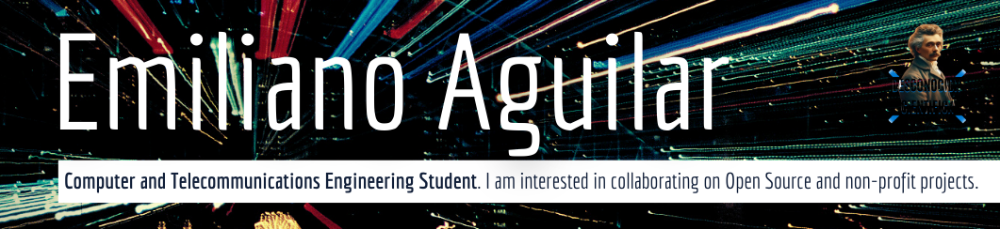

  

  <h1>Emiliano Aguilar</h1>

  <h3>Computer & Telecommunications Engineering Student</h3>

  

    Software Engineering · Data Engineering · Business Intelligence
  

  

    
    
    
  

  

    <a href="https://github.com/Fastreaa?tab=repositories">Projects</a>
    ·
    <a href="https://github.com/Fastreaa?tab=stars">Interests</a>
  

---

## About Me

I'm Emiliano Aguilar, a Computer and Telecommunications Engineering student at Universidad Iberoamericana in Mexico City, interested in building reliable software, data-driven systems, and technology with practical and scientific applications.

My work and projects span several areas of engineering, from backend development and database design to business intelligence, cloud infrastructure, scientific computing, and digital electronics.

I enjoy understanding how systems work, designing solutions to complex problems, and translating technical concepts into useful tools and accessible knowledge.

- **Software Engineering:** Backend development, APIs, database-driven applications, and web technologies.
- **Data Engineering & BI:** SQL, ETL workflows, data modeling, process automation, and analytical reporting.
- **Cloud & Infrastructure:** Cloud services, Linux environments, Docker, integrations, and deployment workflows.
- **Scientific Computing:** Python, ROOT, numerical analysis, and physics data analysis.
- **Computer Engineering:** Digital logic, sequential circuits, hardware experimentation, and embedded systems.
- **Science Communication:** Developing accessible science content and educational initiatives for a community of over 300,000 followers.
- **Digital Entrepreneurship:** Web development, e-commerce, custom digital solutions, and automation.

I'm particularly interested in projects that combine software architecture, data, scientific thinking, and real-world problem-solving.

## Technical Skills

### Programming Languages

  

Python · Java · C · C# · JavaScript · HTML · CSS

### Data Engineering & Business Intelligence

  
  
  
  
  

- Relational databases, SQL querying, and data modeling
- ETL processes and data integration
- Data cleaning, transformation, and validation
- Business intelligence and analytical dashboards
- Data visualization and reporting
- Workflow automation and API-based integrations

### Backend Development & APIs

  

- Backend application development
- REST API integration and implementation
- Database connectivity and data persistence
- Service integration and automation
- Application architecture and maintainable code

### Cloud, DevOps & Infrastructure

  

- Cloud platforms and infrastructure fundamentals
- Linux environments and development workflows
- Docker and containerization fundamentals
- Version control with Git and GitHub
- Application deployment and environment configuration
- Cloud-based automation and service integrations

### Web Development

  

- Responsive web interfaces
- React and Next.js
- Component-based development
- Web application deployment
- E-commerce and digital product development

### Scientific Computing & Research

  
  
  

- Scientific data analysis and numerical computation
- Particle physics data analysis
- Data visualization and statistical exploration
- Computational methods and mathematical modeling

### Digital Electronics & Hardware

  
  

- Combinational and sequential logic
- Digital circuit design and simulation
- Multiplexers, registers, and arithmetic logic
- Hardware troubleshooting and component integration
- Embedded systems experimentation

---

## Featured Projects

### Scientific Computing — Muon Invariant Mass Analysis

A particle physics analysis project using open CMS data to reconstruct and study the invariant mass of dimuon pairs.

**Technologies:** Python, CERN ROOT, scientific data analysis.

The project explores the relationship between experimental data, particle physics, and computational methods. It was presented at the 2024 National Physics Congress.

### Data Engineering & Business Intelligence

Projects focused on transforming raw data into useful information through data processing, database systems, automation, and analytical reporting.

**Areas:** SQL, ETL, data modeling, Power BI, APIs, and workflow automation.

### Backend & Automation Systems

Explorations in building software integrations and database-driven workflows to reduce repetitive tasks and improve the reliability of information processing.

**Areas:** Python, REST APIs, SQL, automation, and cloud infrastructure.

### Digital Electronics & Computer Architecture

Hands-on engineering exercises involving logic circuits, sequential systems, arithmetic logic units, memory components, and circuit simulation.

**Areas:** Logisim, digital logic, electronic components, and hardware troubleshooting.

### Web Development & Digital Products

Independent development initiatives focused on modern web applications, e-commerce, custom digital tools, and practical automation solutions.

**Areas:** JavaScript, React, Next.js, responsive interfaces, and API integration.

### Science Communication & Educational Technology

Science communication and educational initiatives focused on making scientific and technological concepts accessible to a broad audience.

The community behind these initiatives has reached more than 300,000 followers.

---

## Engineering Principles

I aim to approach software development with an emphasis on:

- **Maintainability:** Clear code, modular design, and separation of concerns.
- **Software Architecture:** Appropriate abstractions, SOLID principles, and solutions aligned with project complexity.
- **Data Integrity:** Validation, consistency, traceability, and responsible data handling.
- **Security & Privacy:** Least-privilege access, secure configuration, and protection of sensitive information.
- **Automation:** Reproducible workflows that reduce manual effort and operational errors.
- **Continuous Learning:** Exploring new technologies through practical implementation and experimentation.

## Beyond Software

My interests extend beyond programming into physics, philosophy, scientific research, digital electronics, and critical thinking.

I also enjoy creating educational content, exploring the social impact of technology, and developing independent digital projects.

I believe engineering is not just about making systems work; it is about understanding the problem, making thoughtful design decisions, and building solutions that remain useful over time.

## GitHub Activity

  

  

  

## Connect

  

  

  Engineering · Data · Science · Technology

