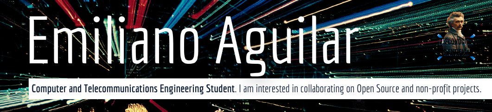

  

    

  

  

    
    
    
  

---

## About

Computer and Telecommunications Engineering student focused on building reliable software, data systems, and AI-powered tools with practical and scientific applications.

I like understanding how systems work end to end: from the data model and the backend, to the automation that connects everything, to the interface someone actually uses. Lately most of my work sits at the intersection of **data engineering** and **applied AI**.

<table>
  <tr>
    <td width="50%" valign="top">
      <b>Currently working on</b> 
      AI-assisted automation, LLM integrations and data pipelines
    </td>
    <td width="50%" valign="top">
      <b>Interested in</b> 
      Open source, scientific computing, physics and science communication
    </td>
  </tr>
</table>

---

## Applied AI

Projects where I integrate language models into real workflows, not just demos.

| Project | What it does | Stack |
|---|---|---|
| **LLM-powered automation** | Pipelines that use language models to read, classify and extract structured data from unstructured text, reducing manual review work. | Python · LLM APIs · SQL |
| **Document Q&A (RAG)** | Retrieval-augmented assistant that answers questions over a document collection, citing the source passages it used. | Python · Embeddings · Vector search |
| **AI agents with tools** | Assistants that call APIs and databases to complete multi-step tasks, with validation on every step. | Python · REST APIs · Tool calling |
| **AI-built web apps** | Web interfaces that put model capabilities behind a clean, usable UI. | React · Next.js · Vercel |

**Approach:** structured outputs, input validation, prompt evaluation, and keeping sensitive data out of model calls.

---

## Featured Projects

<table>
  <tr>
    <td width="50%" valign="top">
      <h4>Muon Invariant Mass Analysis</h4>
      Python · CERN ROOT
      
Reconstruction and analysis of the invariant mass of dimuon pairs using open CMS data. Presented at the 2024 National Physics Congress.

    </td>
    <td width="50%" valign="top">
      <h4>Data Engineering & BI</h4>
      SQL · ETL · Power BI · APIs
      
Turning raw data into reliable information through modeling, cleaning, automated ETL workflows and analytical dashboards.

    </td>
  </tr>
  <tr>
    <td width="50%" valign="top">
      <h4>Backend & Automation</h4>
      Python · REST APIs · Docker · Cloud
      
Service integrations and database-driven workflows that remove repetitive tasks and make information processing more reliable.

    </td>
    <td width="50%" valign="top">
      <h4>Digital Electronics</h4>
      Logisim · Digital logic · Raspberry Pi
      
Sequential circuits, ALUs, registers and memory components, from simulation to hardware experimentation.

    </td>
  </tr>
  <tr>
    <td width="50%" valign="top">
      <h4>Web & Digital Products</h4>
      React · Next.js · Tailwind
      
Independent web applications, e-commerce and custom digital tools with responsive interfaces.

    </td>
    <td width="50%" valign="top">
      <h4>Science Communication</h4>
      Education · Content
      
Making science and technology accessible to a community of more than 300,000 followers.

    </td>
  </tr>
</table>

---

## Tech Stack

**Languages**

  

**Data & BI**

  
   
  
  
  
  

**AI & LLMs**

  
  
  
  
  

**Backend & APIs**

  

**Cloud & DevOps**

  

**Web**

  

**Scientific Computing & Hardware**

  
  
  
  

---

## How I Build

- **Maintainability:** clear code, modular design and separation of concerns.
- **Right-sized architecture:** abstractions that match the complexity of the problem.
- **Data integrity:** validation, consistency and traceability.
- **Security & privacy:** least privilege, secure configuration and care with sensitive data, especially around AI.
- **Automation:** reproducible workflows that reduce manual effort and errors.

---

